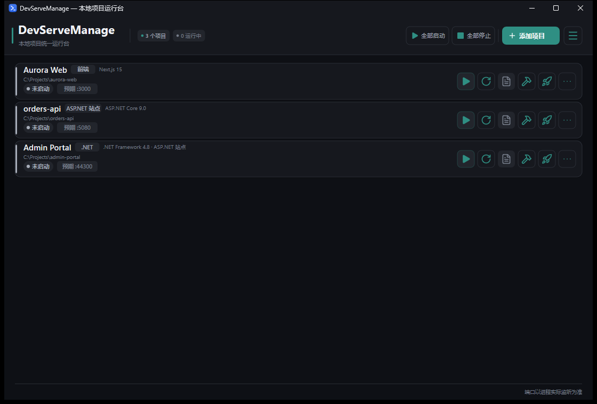
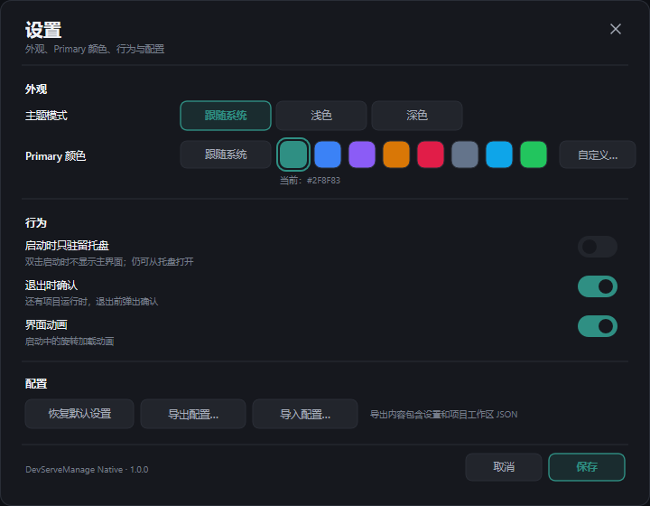
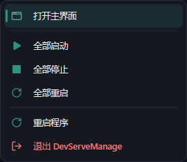
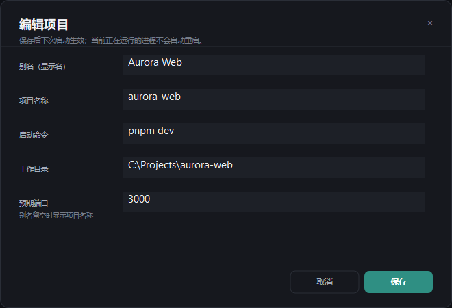
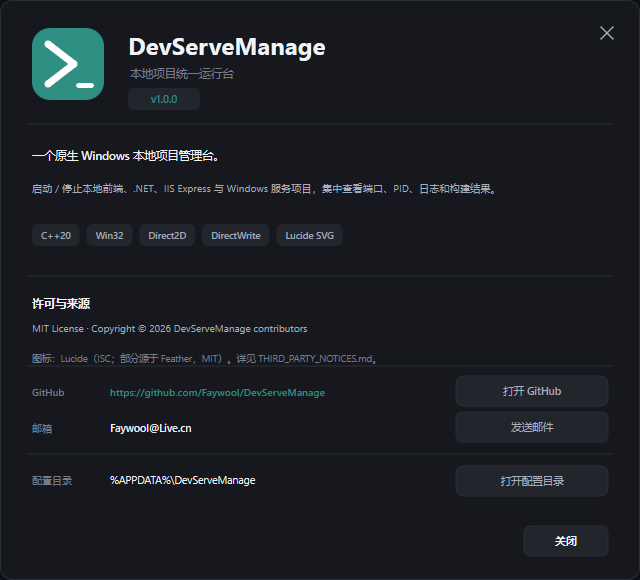

# DevServeManage

**一个原生 Windows 本地项目运行台。**  
把散落在多个终端里的前端 dev server、.NET Web API、IIS Express 站点和 Windows 服务收进一个常驻托盘的小工具。

> GitHub: [Faywool/DevServeManage](https://github.com/Faywool/DevServeManage)  
> Contact: [Faywool@Live.cn](mailto:Faywool@Live.cn)

- **C++20 + Win32 + Direct2D + DirectWrite**
- 单文件原生 exe
- 项目自动识别、启动 / 停止 / 重启、端口 / PID / 运行时长 / 日志
- 卡片式 Debug / Release 构建，托盘快速查看，设置与 JSON 配置导入导出
- MIT License



> 截图使用虚构的示例项目，不包含真实项目路径。

## 功能

| 能力 | 说明 |
|---|---|
| 项目识别 | `package.json` 前端、`*.csproj` .NET / ASP.NET Core、`web.config` + IIS Express、`ProjectInstaller*.cs` Windows 服务 |
| 启动 / 停止 / 重启 | 使用 Job Object 管理整棵进程树，停止时连同 `node` / `dotnet` / `cmd` 子进程一起结束 |
| 实际端口 | 读取 Windows TCP LISTENER 表，IPv4 + IPv6，包含监听 `127.0.0.1` 的 Vite / Next 项目 |
| 运行信息 | 状态、PID、实际端口、启动时长、退出码、最近错误 |
| 列表行按钮 | 启动/停止、重启、日志、Debug 编译、Release 编译、更多，全部为 32×32 图标按钮 |
| 编译 | Debug / Release 构建，输出目录自动识别；Release 成功后自动打开输出目录 |
| 日志 | 每个项目独立日志；手动停止项目后清空该项目的运行日志；无日志时日志按钮禁用 |
| 服务 | 识别 `ServiceInstaller` 中的服务名；未安装时卡片按钮变为「安装服务」，通过 UAC 调用 `InstallUtil.exe` 注册并启动；Windows 服务列表中的显示名称使用项目名称，SCM 内部服务名仍使用 `ServiceInstaller` 定义的名字 |
| 端口冲突 | 启动前检查；运行失败时识别 `EADDRINUSE`，提示结束占用进程并重启 |
| 扩展菜单 | 打开目录、日志、复制路径、编辑项目、打开 Debug/Release 输出、移除 |
| 托盘 | 快速查看浮层；图标右键菜单；全部启动 / 停止 / 重启 / 重启程序 / 退出 |
| 设置 | 独立设置窗口：主题、Primary 颜色、启动仅托盘、退出确认、动画、配置导入导出、关于 |
| 图标 | [Lucide](https://lucide.dev/) SVG 图标库，运行时解析为 Direct2D geometry；支持主题着色和矢量缩放 |

### 支持的识别类型

| 类型 | 入口 | 启动方式 |
|---|---|---|
| React / Vue / Svelte / Next.js 等前端 | `package.json` 的 `scripts.dev` | `npm / pnpm / yarn / bun run dev` |
| ASP.NET Core / .NET Worker / 控制台 | `*.csproj` + `launchSettings.json` | `dotnet run --project ...` |
| 传统 ASP.NET（.NET Framework） | `web.config` / `UseIISExpress` | IIS Express |
| .NET Framework Windows 服务 | `ProjectInstaller*.cs` / `ServiceBase` | Windows SCM |
| .NET Framework 控制台 / WinForms / WPF | `*.csproj` | `bin\Debug\*.exe` |

> Windows 服务项目的入口如果无条件调用 `ServiceBase.Run(...)`，不能像普通控制台程序一样直接运行。DevServeManage 会在未安装时把卡片主按钮变成「安装服务」，通过 UAC 调用项目的 `InstallUtil.exe` 注册并启动，之后即可通过 SCM 启停。
>
> 项目名称、Windows 服务显示名称、SCM 服务名是三个不同概念：显示名称会设置为项目名称；SCM 服务名由项目 `ServiceInstaller.ServiceName` 决定（例如项目 `Acme.OrderService` 的服务名可能是 `OrderService`），不能随意改成项目名称，否则服务进程无法向 SCM 注册。需要让 SCM 服务名也等于项目名称时，必须修改项目里的 `ServiceName` 后重新编译安装。详见 [native/README.md](native/README.md#windows-service-能不能像-f5-一样直接运行)。

## 构建

### 环境

- Windows 10 / 11
- [w64devkit](https://github.com/skeeto/w64devkit)（MinGW-w64 / GCC，含 `windres`）
- PowerShell 7 或 Windows PowerShell 5.1

只需要 Windows 和 w64devkit；如果项目本身使用 .NET Framework / IIS Express，仍需本机安装对应的 MSBuild / IIS Express。

### 编译

```powershell
$env:W64DEVKIT = 'C:\path\to\w64devkit'
cd native
.\build.ps1
```

输出：

```text
native\dist\DevServeManage.exe
```

构建脚本会用 `windres` 编译图标 / manifest / 版本资源，再用 `g++` 静态链接 libgcc / libstdc++，生成单文件 exe。

## 运行

```powershell
.\native\dist\DevServeManage.exe
```

- 关闭主窗口 = 收进托盘。
- 托盘图标右键菜单可打开主界面、全部启动 / 停止 / 重启、重启程序或退出。
- Windows 11 可能把新托盘图标放入 `^` 溢出区；从 `^` 中拖到任务栏固定一次即可。

### 第一次添加项目

1. 点击右上角「添加项目」，选择项目根目录；
2. 或直接把文件夹拖进主窗口；
3. 自动识别完成后，可在「…」→「编辑项目」修改别名、名称、启动命令、工作目录和预期端口。

## 设置

主界面右上角汉堡按钮 →「设置」打开独立设置窗口：

- 主题：跟随系统 / 浅色 / 深色
- Primary 颜色：跟随系统、8 个预设色、自定义取色
- 启动时只驻留托盘
- 退出时确认
- 界面动画
- 恢复默认设置
- 导出 / 导入 JSON 配置
- 关于



设置文件：

```text
%APPDATA%\DevServeManage\settings.json
```

项目工作区：

```text
%APPDATA%\DevServeManage\workspace.json
```

运行日志：

```text
%APPDATA%\DevServeManage\logs\<项目名>.log
```

导出的配置包含：

```json
{
  "settings": { "...": "..." },
  "workspaceJson": "..."
}
```

导入的项目工作区在点击「保存」后写入，下次启动生效。

## 截图









## 项目结构

```text
DevServeManage/
├─ native/
│  ├─ src/
│  │  ├─ main.cpp        Win32 主窗口、Direct2D 列表、列表行按钮
│  │  ├─ core.h/.cpp     项目模型、workspace、进程/端口/服务、项目识别
│  │  ├─ json.h          轻量 JSON 解析器
│  │  ├─ tail.inc        托盘、快速查看浮层、入口
│  │  ├─ dialogs.inc     应用内消息框、项目编辑窗口
│  │  ├─ menu.inc        Direct2D 自绘菜单、菜单输入处理
│  │  ├─ settings.inc    设置窗口、配置导入导出
│  │  └─ about.inc       关于窗口
│  ├─ res/               应用图标与托盘状态图标
│  ├─ app.rc             图标、manifest、版本资源
│  ├─ app.manifest       DPI / 兼容性声明
│  ├─ build.ps1          w64devkit 构建脚本
│  ├─ docs/              README 截图
│  └─ THIRD_PARTY_NOTICES.md
├─ LICENSE               MIT
└─ README.md
```

## 设计说明

- **原生**：没有 UI 框架运行时，只有一个 Win32 消息循环和 Direct2D 渲染目标。
- **稳定驻留**：关闭主窗口只隐藏；托盘窗口独立存在；固定 GUID 防止残留图标。
- **输入处理**：托盘自绘菜单不依赖 Windows 前台锁，使用低级鼠标钩子 + 定时轮询处理悬停、点击和点击外部关闭。
- **进程管理**：每个项目使用独立 Job Object，强杀主进程时能清理子进程树。
- **端口**：使用 `GetExtendedTcpTable` 读取监听表，实际端口优先于配置端口。

## 已知限制

- Windows 服务无法在未安装时直接运行（具体取决于项目入口是否支持 console 模式）。
- 构建命令来自项目配置；首次使用 .NET Framework / IIS Express 前需要本机已安装对应的 MSBuild / IIS Express。
- 当前只提供 Windows 版本。
- 设置中的「启动时只驻留托盘」只在下次启动生效。

## 第三方与许可

本项目源代码使用 **MIT License**，见 [LICENSE](LICENSE)。

图标来自 [Lucide](https://lucide.dev/)（`lucide-static` 1.69.0）：

- Lucide: ISC License
- 部分 Feather 衍生图标: MIT License
- 完整许可见 [native/THIRD_PARTY_NOTICES.md](native/THIRD_PARTY_NOTICES.md)

仓库只包含原生 C++ 代码和构建资源。构建工具 w64devkit、Windows SDK / MinGW 头文件不随源码分发；生成的 exe 静态链接 GCC 运行库（受 GCC Runtime Library Exception 约束）。

### 许可证审计

- 应用源代码：原创，MIT。
- 图标：Lucide（ISC）+ 部分 Feather 衍生图标（MIT）；声明见 [native/THIRD_PARTY_NOTICES.md](native/THIRD_PARTY_NOTICES.md)。
- 应用图标、托盘图标、截图：项目资产，随项目 MIT 发布；截图使用虚构示例项目。
- 字体：使用 Windows 自带的 Segoe UI，不分发字体文件。
- 构建工具：w64devkit / MinGW-w64 / GCC 为外部工具，不随源码分发。
- 未包含闭源 UI 运行时或第三方闭源组件。
- 未发现需要在 MIT 之外单独授权的应用代码；如果后续加入第三方代码，请同步更新 `THIRD_PARTY_NOTICES.md` 和本节。

## 贡献

欢迎提交 issue / pull request。提交前请：

1. 使用 `native/build.ps1` 确认可编译；
2. 不提交 `native/build/`、`native/dist/`、`dist/`、日志或本地配置；
3. 保留 Lucide 的版权与许可声明；
4. UI 变更附截图或简短说明。

## 仓库状态

代码已整理为仅 C++ / Win32 版本。

远程仓库已配置为 `origin`；本次没有执行 commit 或 push，推送前请先检查 `git status` 并补充自己的仓库说明/发布信息。
