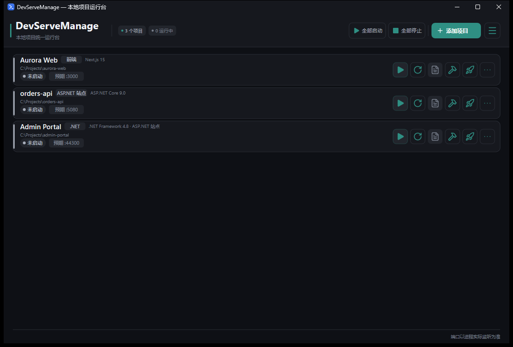
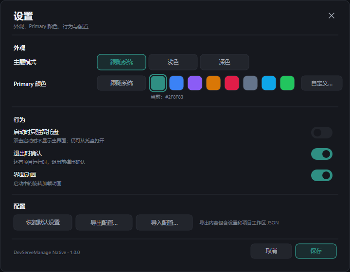
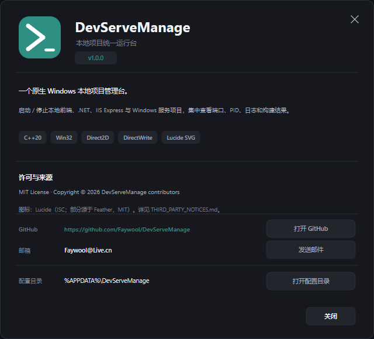

# DevServeManage Native

Win32 + Direct2D + DirectWrite 原生实现。  
发布为单个约 4 MB 的 exe。

GitHub: [Faywool/DevServeManage](https://github.com/Faywool/DevServeManage)  
Contact: [Faywool@Live.cn](mailto:Faywool@Live.cn)

项目总览、功能列表和快速开始见根目录 [README.md](../README.md)。



## 技术栈

- C++20
- Win32 / Shell_NotifyIcon / Job Object / Toolhelp / SCM
- Direct2D + DirectWrite
- [Lucide](https://lucide.dev/) SVG 图标（运行时解析为 Direct2D geometry）
- w64devkit / MinGW-w64 构建

## 代码结构

```text
native/
├─ src/
│  ├─ main.cpp        主窗口、Direct2D 列表、列表行按钮、项目管理 UI
│  ├─ core.h/.cpp     项目模型、workspace JSON、进程/端口/服务、项目识别
│  ├─ json.h          轻量 JSON 解析器
│  ├─ tail.inc        托盘、快速查看浮层、入口
│  ├─ dialogs.inc     应用内消息框、项目编辑窗口
│  ├─ menu.inc        Direct2D 自绘右键菜单、鼠标输入处理
│  ├─ settings.inc    设置窗口、配置导入导出
│  └─ about.inc       关于窗口
├─ res/               应用图标和托盘状态图标
├─ docs/              README 截图
├─ app.rc             图标、manifest、版本资源
├─ app.manifest       DPI / 兼容性声明
├─ build.ps1          w64devkit 构建脚本
└─ THIRD_PARTY_NOTICES.md
```

## 构建

要求：

- Windows 10 / 11
- [w64devkit](https://github.com/skeeto/w64devkit)（GCC + windres）
- PowerShell

```powershell
$env:W64DEVKIT = 'C:\path\to\w64devkit'
cd native
.\build.ps1
```

输出：

```text
native\dist\DevServeManage.exe
```

构建过程：

1. `windres` 编译 `app.rc`（图标、manifest、版本资源）；
2. `g++ -std=c++20 -O2` 编译 `src/main.cpp`、`src/core.cpp`；
3. 静态链接 libgcc / libstdc++ 和 Windows 系统库；
4. 生成不依赖 MinGW 运行库的单文件 exe。

`native/build/` 和 `native/dist/` 是构建产物，不进入 Git。

## 运行

```powershell
.\native\dist\DevServeManage.exe
```

- `--tray`：只驻留托盘，不显示主窗口。
- 关闭主窗口只是隐藏，进程继续在托盘运行。
- 退出请使用托盘右键菜单 →「退出 DevServeManage」。

## 数据目录

```text
%APPDATA%\DevServeManage\
├─ workspace.json     项目列表与每个项目的启动/构建配置
├─ settings.json      主题、Primary 颜色、行为和配置开关
├─ logs\              每个项目的运行日志
└─ native.log         应用诊断日志
```

项目日志会在手动停止项目时清空；应用日志用于排查托盘/进程问题。

## 设置

设置是独立的 Direct2D 窗口：

- 主题：跟随系统 / 浅色 / 深色
- Primary 颜色：跟随系统、8 个预设、自定义取色
- 启动时只驻留托盘
- 退出时确认
- 界面动画
- 恢复默认
- 导出 / 导入 JSON 配置
- 关于



配置导出内容：

```json
{
  "settings": { "...": "..." },
  "workspaceJson": "..."
}
```

项目工作区在点击「保存」后写入，下次启动生效。

## 托盘与菜单实现

- 托盘使用固定 GUID，避免进程重启后残留重复图标。
- 图标右键菜单是 Direct2D 自绘窗口：
  - `TOPMOST`；
  - 位置限制在 `rcWork` 内，避免被任务栏遮挡；
  - 整行悬停高亮 + 左侧强调色竖条；
  - 点击菜单外关闭。
- Windows 可能拒绝 `SetForegroundWindow`，因此菜单输入不依赖前台窗口：
  - `WH_MOUSE_LL` 低级鼠标钩子处理悬停/按下；
  - 30ms 光标轮询兜底；
  - `WM_ACTIVATE`/`WM_CAPTURECHANGED`/定时器负责关闭。
- 重复托盘回调由 `g_customMenu` + `IsCustomMenuOpen()` 防重入，避免叠出多个菜单。

## Windows Service 能不能像 F5 一样直接运行？

取决于项目入口。

如果 `Program.cs` 无条件调用：

```csharp
ServiceBase.Run(new MyService());
```

没有 `Environment.UserInteractive` 或 `--console` 分支，直接运行 exe 会被 SCM 拒绝（错误 1063）。Visual Studio 对这类 `ServiceBase` 项目做 F5 调试通常也需要先安装服务，或附加到已经运行的服务进程。

DevServeManage 对这类项目的处理：

- 从 `*Service.Designer.cs` 或 `ProjectInstaller.Designer.cs` 识别 SCM 服务名；
- 服务未安装时，卡片主按钮显示「安装服务」；
- 点击后弹确认，以管理员权限（UAC）运行 `InstallUtil.exe <bin\Debug\服务.exe>`；
- 安装后用 `sc config ... DisplayName=` 把 Windows 服务列表里的显示名称设置为项目名称；
- 安装成功后自动调用 SCM 启动服务；
- 之后卡片按钮直接通过 SCM 启动 / 停止，不再需要手动打开服务管理器。

注意：**显示名称**可以等于项目名称，但 **SCM 服务名**必须使用项目 `ServiceInstaller.ServiceName`。例如项目名是 `Acme.OrderService`，代码中的服务名可能是 `OrderService`；如果把 SCM 服务名强行改成 `Acme.OrderService`，`ServiceBase.Run` 会找不到对应服务而启动失败（1083/1060）。要让 SCM 服务名也等于项目名，需要修改 `*Service.Designer.cs` 和 `ProjectInstaller.Designer.cs` 中的 `ServiceName` 后重新编译安装。

因此在应用内可以支持这类服务项目，但首次安装仍然需要管理员权限；它不能绕过 SCM 直接以普通进程运行。

现代 .NET Worker 如果使用 `UseWindowsService()`，通常可以直接 `dotnet run`，因为 `WindowsServiceLifetime` 会检测到进程不是由 SCM 启动，从而以控制台方式运行。

项目菜单里的「直接运行（不安装服务）…」会说明具体项目是否支持。

## 图标与许可

图标来自 [Lucide](https://lucide.dev/)（`lucide-static` 1.69.0）：

- Lucide: ISC License
- 部分 Feather 衍生图标: MIT License
- 完整声明：[THIRD_PARTY_NOTICES.md](THIRD_PARTY_NOTICES.md)

应用代码使用 MIT License，见根目录 [LICENSE](../LICENSE)。



## 已知限制

- 仅支持 Windows。
- Windows 服务直接运行能力取决于项目入口代码。
- 首次使用 .NET Framework / IIS Express 前，系统需要已安装 MSBuild / IIS Express。
- 构建命令来自项目配置；本工具不负责安装项目依赖。
- 「启动时只驻留托盘」在下次启动时生效。
